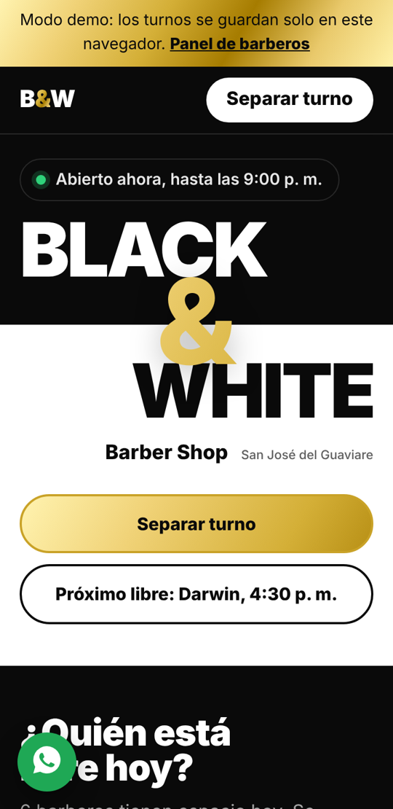
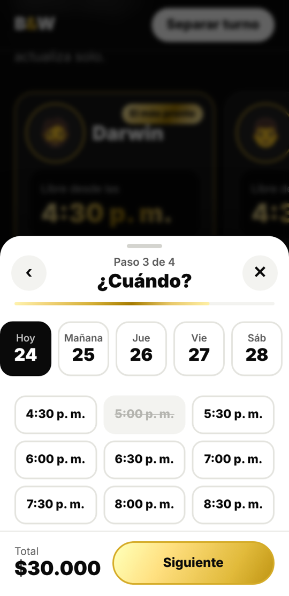
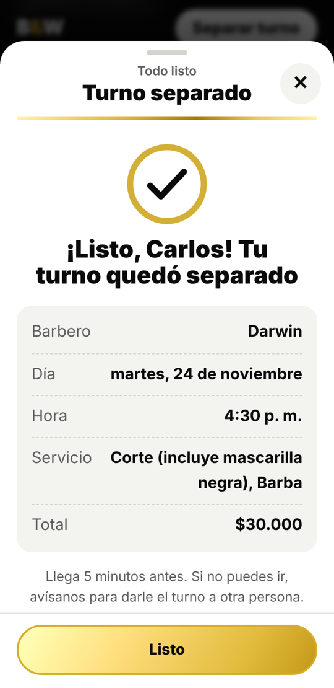
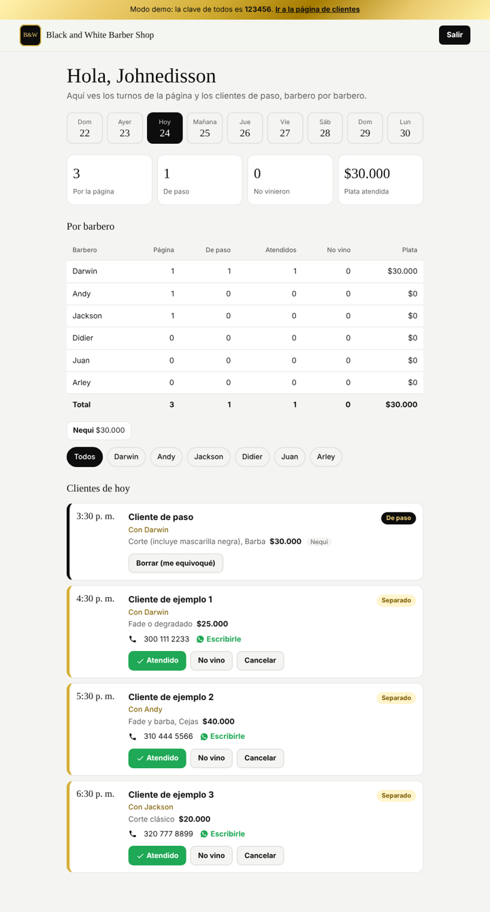

# Black and White Barber Shop

**Mobile-first booking web app for my family's barbershop in San José del Guaviare, Colombia.**

Clients see which barber is free *right now*, pick a service and a time, and book in under a minute, no app store and no WhatsApp back-and-forth. Barbers get a private panel on their phones, and the owner sees every booking, walk-in and payment from anywhere.

🔗 **Live:** [blackandwhitebarbershop.netlify.app](https://blackandwhitebarbershop.netlify.app)

<p>
  
  
  
</p>

## Why I built it

85% of the shop's customers browse on their phones, most clients are loyal to one barber, and many people still walk in. The owner (my brother) isn't always in the shop, and the barbers didn't want to share their personal numbers. The goal was a system that works the way the shop already works, instead of forcing a generic booking platform on it.

## Features

**For clients**
- Live "Who's free today?" cards: each barber's next open slot, updated every minute; the soonest one is highlighted
- 4-step booking sheet (barber → services → day & time → details) with progress bar, running total, haptic feedback and swipe-to-close
- Taken slots disappear in real time, so two clients can't book the same barber at the same time
- "Any available barber" option assigns the first free one
- Installable as an app (PWA) with its own home-screen icon
- Open/closed status and today's hours, computed in Colombia's time zone

**For barbers** (`/panel.html`)
- Private login; each barber only sees his own bookings
- Sound and toast alert when a new booking arrives (Supabase Realtime)
- Mark bookings as attended, no-show or cancelled, recording the payment method
- Register walk-in clients (services, total, payment); their current half-hour is blocked automatically
- Block time for lunch or errands

**For the owner**
- Every booking and walk-in across all barbers, by day
- Per-barber totals (online vs walk-in, attended, no-shows, revenue) and a breakdown by payment method



## Tech stack

| Layer | Choice | Why |
|---|---|---|
| Front end | HTML, CSS, vanilla JavaScript | No build step and very light, so it loads fast on slow rural mobile data |
| Database & auth | [Supabase](https://supabase.com) (PostgreSQL, Auth, Realtime) | Free tier, row-level security, live updates |
| Hosting | Netlify | Free HTTPS, deploys from this repo |
| App install | Web App Manifest + Service Worker | "Install app" without the app stores |

## How it's secured

- **Row Level Security** on every table: anyone can *create* a booking, but only signed-in staff can *read* bookings, and each barber only sees his own.
- The public page never receives client names or phone numbers. It calls a `SECURITY DEFINER` function (`taken_slots`) that returns only `barber_id` and `time`.
- A partial unique index prevents double booking at the database level, even if two people tap at the same moment.
- Database checks validate phone format, status values, booking window and lengths.
- Only the publishable (public) key is in the front end; no secret keys are in this repository.

## Project structure

```
site/               Static site published by Netlify
  index.html        Client page
  app.js            Live availability + booking flow
  panel.html/.js    Barber & owner panel
  common.js         Shared helpers + data layer (demo mode or Supabase)
  config.js         All shop data: barbers, hours, prices, keys
  sw.js             Service worker (installable app, offline fallback)
supabase/           SQL to create the database, in order
docs/               Screenshots
```

## Run it yourself

1. Open `site/index.html` in a browser. With `mode: "demo"` in `config.js`, everything runs locally (bookings are saved in the browser; panel password `123456`).
2. For the real version: create a Supabase project, run the files in `supabase/` in order, create the staff users, put your project URL and publishable key in `config.js`, and set `mode: "supabase"`.
3. Deploy: connect this repo to Netlify (the publish folder `site` is already set in `netlify.toml`).

## What's next

- Real photos of the barbers and their work
- Own domain
- Monthly reports for the owner

---

### En español

Página web y sistema de turnos para la barbería de mi familia en San José del Guaviare. Los clientes ven en vivo qué barbero está libre y separan su turno desde el celular. Cada barbero tiene su panel privado y el dueño ve todos los turnos, los clientes de paso y la plata del día. Hecho con HTML, CSS y JavaScript, con Supabase como base de datos, y publicado en Netlify.

*Built by Jonathan Mosquera Murillo, Computer Programming student at Algonquin College, Ottawa.*
